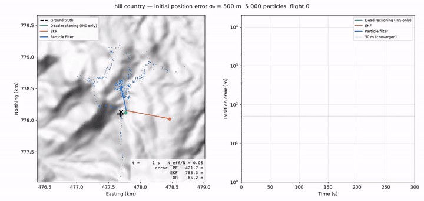
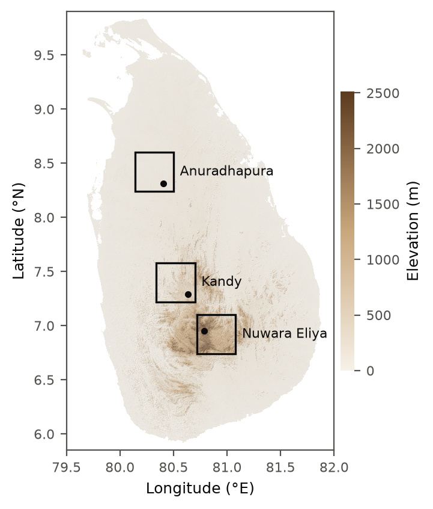
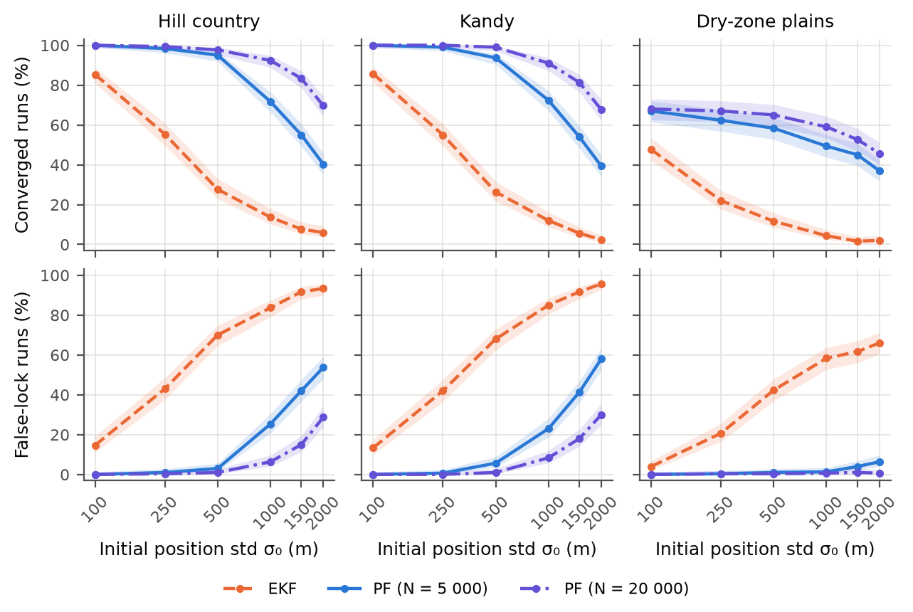
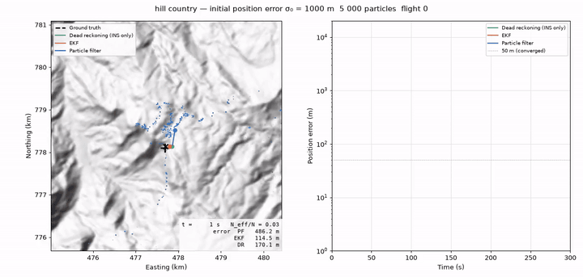
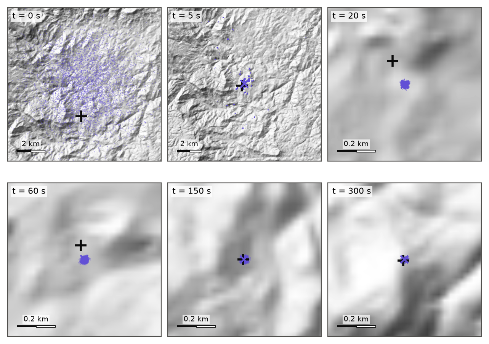

<div align="center">

# Terrain-Aided Navigation with a Particle Filter

**A GPS-denied UAV finds its position by matching altimeter readings against real Copernicus
terrain of Sri Lanka — estimated with a particle filter, compared with an EKF and dead reckoning.**

[](https://github.com/KaveeshwaraBandara/terrain-aided-navigation-pf/actions/workflows/ci.yml)




*One simulated flight over the central highlands (initial error σ₀ = 500 m): the particle cloud
(blue dots) collapses onto the true position within seconds, the EKF drifts off and dead reckoning
slowly drifts. Make your own with `make demo`.*

EN4594 Autonomous Systems — mini project · G.A.M.I.K. Bandara (220059J) · University of Moratuwa

</div>

---

## Contents

[At a glance](#at-a-glance) · [The problem](#the-problem) · [Estimators](#estimators) ·
[Study regions](#study-regions) · [Results](#results) · [Run it](#run-it) ·
[Reproduce everything](#reproduce-everything) · [Validation](#validation) ·
[Repository layout](#repository-layout) · [Documentation](#documentation) ·
[References](#references)

## At a glance

| | |
|---|---|
| **Problem** | GNSS lost → the INS drifts. Barometric minus radar altitude = terrain height under the aircraft; match it against a stored elevation map |
| **Main estimator** | Vectorised, log-domain SIR particle filter (four resampling schemes, roughening, Student-t likelihood, offset state, online false-lock monitor) and a Rao-Blackwellised variant |
| **Baselines** | Extended Kalman filter (DEM slope as Jacobian), INS dead reckoning |
| **Terrain** | Copernicus GLO-30 (30 m surface model): three 40 km × 40 km regions chosen by a pre-registered roughness rule |
| **Evaluation** | 7 Monte Carlo experiments, ≈ 17 000 simulated flights, common random numbers, Wilson / bootstrap intervals, McNemar paired tests, posterior Cramér–Rao bound |
| **Speed** | 0.83 ms per step with 5 000 particles on one laptop core — ≈ 1 200× faster than the 1 Hz altimeter rate |

## The problem

When GNSS is jammed or unavailable, a UAV's inertial navigation integrates a velocity with a slowly
wandering bias, so its position error grows without bound. The difference between the barometric
altitude (above sea level) and the radar altitude (above the ground) is the height of the terrain
directly below; comparing a sequence of these heights with an onboard elevation map pins down
where the aircraft is:

$$
\mathbf{x}_k = [p_x,\ p_y,\ b_x,\ b_y]^\top,\qquad
\mathbf{p}_k = \mathbf{p}_{k-1} + \Delta t\,(\mathbf{u}_k - \mathbf{b}_{k-1}) + \mathbf{w}_p,\qquad
z_k = \text{baro}_k - \text{radar}_k = h(\mathbf{p}_k) + v_k
$$

with $h$ the bilinearly interpolated DEM height and $\mathbf{u}_k$ the INS velocity. One measurement
only constrains the position to a contour line, so the posterior is **nonlinear and often
multimodal** — exactly where a particle filter beats a linearised filter.

## Estimators

| Estimator | Role |
|---|---|
| `ParticleFilter` | Bootstrap SIR filter: vectorised predict/update, log-domain weights, systematic / stratified / residual / multinomial resampling, roughening. Options: Student-t likelihood (radar outliers), measurement-offset state (barometer bias, canopy), divergence monitor (windowed NIS test + re-spread from the dead-reckoning belief) |
| `RaoBlackwellizedPF` | Particles carry the position; a Kalman filter per particle carries the INS bias, all sharing one Riccati recursion |
| `ExtendedKalmanFilter` | Linearised baseline with the DEM slope as Jacobian and a Joseph-form update |
| `DeadReckoning` | INS only — the lower bar |
| `tan.pcrb` | Posterior Cramér–Rao bound with the true simulation noise, plus a mismatched-gain analysis that separates the effect of tuning from the particle approximation |

## Study regions



The three boxes were chosen on a 90 m survey of the island by a rule fixed before any data were
examined: the roughest box around Nuwara Eliya, the flattest around Anuradhapura, and around Kandy
the one closest to the geometric mean of the two (no Kandy box is truly "moderate", so the least
rough one was taken).

| Region | 1 km roughness | Information per altimeter sample |
|---|---|---|
| Hill country (Nuwara Eliya) | 64.5 m | 13.5 × 10⁻³ m⁻² |
| Kandy (mid-country) | 37.7 m | 7.4 × 10⁻³ m⁻² |
| Dry-zone plains (Anuradhapura) | 3.5 m | 0.16 × 10⁻³ m⁻² |
| Synthetic reference | 62.7 m | 5.6 × 10⁻³ m⁻² |

One altimeter sample over the hills carries ≈ 84× the position information of one over the plains.
Details in [`data/README.md`](data/README.md) and `report/tables/terrain_stats.csv`.

<br clear="right">

## Results

### Particle filter vs EKF — and how early linearisation fails



Hill country, 300 random flights per cell — converged runs (false-lock runs in brackets):

| Initial error σ₀ | EKF | PF, 5 000 particles | PF, 20 000 particles |
|---|---|---|---|
| 100 m | 85 % (15 %) | 100 % (0 %) | 100 % (0 %) |
| 500 m | 28 % (70 %) | 95 % (3 %) | 98 % (1 %) |
| 1 000 m | 14 % (84 %) | 72 % (25 %) | 92 % (6 %) |
| 2 000 m | 6 % (93 %) | 40 % (54 %) | 70 % (29 %) |

- On real 30 m terrain the EKF fails much earlier than on smooth synthetic hills (σ₀ = 500 m: 28 %
  vs 68 % convergence under the same protocol); without innovation gating it then ends **worse than
  dead reckoning**. The particle filter beats it in all 18 region × σ₀ cells (McNemar p < 10⁻¹⁰).
- Converged particle-filter runs track at ≈ 7–10 m over the hills and ≈ 21 m over the flat plains,
  where the filter rarely meets the 50 m criterion but **almost never locks falsely**: it stays
  honestly uncertain.

### Watch it fail — and how to fix it



*σ₀ = 1 km, flight 0: the cloud collapses onto a patch of terrain ≈ 400 m from the truth whose
height profile also fits — a confident, wrong answer
(`scripts/live_demo.py --sigma0 1000 --run 0`).*

False lock is the particle filter's characteristic failure. On identical flights at σ₀ = 2 km over
the hill country (300 runs):

| Variant (5 000 particles) | Converged | False lock |
|---|---|---|
| Plain particle filter | 40 % | 54 % |
| + divergence monitor (no ground truth needed) | 84 % | 2 % |
| + roughening (K = 0.05) | 83 % | 16 % |
| **+ monitor + roughening** | **96 %** | **1 %** |

Roughening prevents locks by keeping hypotheses alive while the cloud is still wide; the monitor
detects the locks that still happen (a windowed normalised-innovation test) and re-opens the search.
Together they beat 20 000 particles without them (70 %).

### Particle cloud over real terrain



A run chosen by a fixed rule, not by eye: spread over kilometres at take-off, several hypotheses at
5 s, a temporarily wrong mode at 20–60 s, locked on from 72 s. Full animation:
[`report/figures/visuals_animation.mp4`](report/figures/visuals_animation.mp4).

### All experiments

| | Question | Answer |
|---|---|---|
| **E1** | When does linearisation fail, and does it depend on the terrain? | Already at σ₀ ≈ 100 m on real hills; the particle filter degrades gracefully and fails by false lock |
| **E2** | Does performance follow the terrain under the flight? | Across terrain types yes, with opposite signs (PF ρ = −0.63, EKF ρ = +0.29); within one region only weakly |
| **E3** | Which design choices matter? | Particles buy acquisition, not tracking (29 % → 98 % from 500 to 50 000); resampling scheme and ESS threshold make no significant difference; roughening K = 0.05 lifts convergence 71 % → 94 % |
| **E4** | How robust is it to model errors? | Student-t likelihood holds 94 % with 10 % radar outliers (Gaussian: 42 %); a constant 20 m height offset defeats the nominal filter (0 %), an offset state recovers 48 % |
| **E5** | How close to optimal, and is it consistent? | Never below the posterior Cramér–Rao bound (≥ 1.29×); in tracking 2.05× the bound, almost all of it the deliberate process-noise inflation (1.10× what that tuning allows); covariance conservative |
| **E6** | Can false lock be detected and recovered without ground truth? | Yes: 40 % → 84 % with the monitor, 96 % with roughening as well |
| **E7** | Does Rao-Blackwellising the INS bias help? | Once locked on, bias error 0.30 vs 0.50 m/s and better tracking; the plain filter's bias estimate is no better than the prior (sample impoverishment) |

Every number here and in the report is generated from saved results (`report/tables/*.csv`,
`report/generated/*.tex`). The lab notebook [`report/findings.md`](report/findings.md) records the
setup, numbers and interpretation of every experiment, including the corrections made after an
independent review.

## Run it

Requires Python ≥ 3.10 (Ubuntu: `sudo apt install python3-venv python3-tk` if missing).

```bash
make setup        # virtual environment + package + test tools
make test         # 83 unit tests, ~5 s
make demo         # live animated window (needs the terrain data, see below)
```

The live viewer shows the particle cloud, the truth and every filter's estimate moving over the
terrain, with the position errors updating beside it:

```bash
.venv/bin/python scripts/live_demo.py                                   # hill country, σ₀ = 500 m
.venv/bin/python scripts/live_demo.py --sigma0 1000 --run 0             # a false lock
.venv/bin/python scripts/live_demo.py --region north_central_plains --sigma0 2000
.venv/bin/python scripts/live_demo.py --region synthetic                # no download needed
.venv/bin/python scripts/live_demo.py --particles 20000 --fps 30
.venv/bin/python scripts/live_demo.py --save demo.mp4                   # video instead of a window
```

`--run N` replays flight N of the Monte Carlo experiments exactly. For static plots of one or more
flights: `.venv/bin/python scripts/run_experiment.py --region hill_country --runs 10` (written to
`results/<timestamp>_<region>/`).

## Reproduce everything

Real terrain needs a free [OpenTopography](https://opentopography.org) API key:

```bash
cp .env.example .env     # paste your key into OPENTOPO_API_KEY (never commit .env)
make data                # 4 API calls: island survey + three regions → data/processed/
make benchmark           # runtime per filter step (run on an idle machine)
make experiments         # all experiments, resumable, ≈ 1.5 h on a 10-core laptop
make figures             # every figure, table and number from the saved results (≈ 1 min)
make media               # the README animations in assets/ (needs ffmpeg)
```

`make quick` runs every experiment with 3 runs and short flights; `make smoke` checks the whole
pipeline on synthetic terrain without any download. A single experiment:
`.venv/bin/python scripts/sweep.py --experiment e3 [--quick] [--jobs 10]`, then
`.venv/bin/python scripts/make_figures.py --experiment e3`. Experiments are YAML files in
`configs/experiments/`; every results folder records the git commit, the data checksum, the
resolved configuration and the package versions.

**Report.** `report/latex/main.tex` reads its figures, tables and numbers from
`report/{figures,tables,generated}/`. With TeX installed: `make report`. On Overleaf: upload the
`report/` folder (or a flattened copy with `main.tex` at the top level) and compile with pdfLaTeX.

## Validation

- **Exact reference.** On a tilted plane the EKF is the exact Kalman filter; the RBPF reproduces it
  within 0.19 standard deviations and the particle filter within 0.17 in four of five seeds (the
  fifth is explained by bias impoverishment) — `scripts/validation.py`.
- **Bound.** The PCRB recursion equals the Kalman covariance on the plane (relative difference
  ≈ 3·10⁻¹¹), its true-noise model matches the simulator's empirical noise, and no filter's
  unconditional error ever falls below the ensemble bound.
- **Unit tests (83).** Resampling properties (unbiased, zero-weight particles never chosen,
  systematic = floor/ceil), normalised likelihoods, outlier robustness, monitor behaviour, metric
  closed forms (Wilson, χ², McNemar), common random numbers across configurations, resumable runs,
  API-key redaction in download errors.
- **Report.** `scripts/check_report.py` checks every macro, reference, figure, citation and
  character the LaTeX report uses.

## Repository layout

```
configs/            default.yaml (parameters), regions.yaml (study boxes),
                    experiments/ (e1–e7, smoke; _common.yaml shared settings)
src/tan/
  data.py           OpenTopography download (key never printed), reprojection, crop, manifest
  dem.py            DEM: vectorised bilinear height, slopes, exact interpolant gradient
  terrain.py        roughness, slope, Fisher information (per region and along a flight)
  simulate.py       the world: random flights, INS, altimeters, map error; common random numbers
  filters/          particle filter, RBPF, EKF, dead reckoning, resampling schemes
  pcrb.py           posterior Cramér–Rao bound, mismatched-gain analysis
  metrics.py        convergence, false lock, RMSE, ANEES, Wilson / bootstrap, McNemar
  runner.py         parallel, resumable Monte Carlo runner
  analysis/         saved results → figures, tables and LaTeX macros
scripts/            live_demo, run_experiment, sweep, make_figures, survey_regions,
                    download_dem, terrain_stats, benchmark, validation, extract_listings,
                    check_report
tests/              unit tests
assets/             README animations (make media)
data/               manifest.json with checksums (rasters are downloaded, not committed)
report/             latex/ (report), figures/, tables/, generated/, findings.md, WALKTHROUGH.md
```

## Documentation

| Document | Contents |
|---|---|
| [`report/latex/`](report/latex/) | The project report (Introduction → Conclusion, appendices) |
| [`report/WALKTHROUGH.md`](report/WALKTHROUGH.md) | Equations → code, how to re-run each experiment, what each figure shows, viva questions |
| [`report/findings.md`](report/findings.md) | Lab notebook: setup, numbers, interpretation and decisions for every experiment |
| [`data/README.md`](data/README.md) | Terrain data, API, accuracy and attribution |

## Data attribution

Elevation data: produced using Copernicus WorldDEM-30 © DLR e.V. 2010-2014 and © Airbus Defence
and Space GmbH 2014-2018 provided under COPERNICUS by the European Union and ESA; all rights
reserved. Accessed through OpenTopography.

## References

- N. J. Gordon, D. J. Salmond, A. F. M. Smith, "Novel approach to nonlinear/non-Gaussian Bayesian
  state estimation," *IEE Proceedings F*, 140(2):107–113, 1993.
- M. S. Arulampalam, S. Maskell, N. Gordon, T. Clapp, "A tutorial on particle filters for online
  nonlinear/non-Gaussian Bayesian tracking," *IEEE Trans. Signal Processing*, 50(2):174–188, 2002.
- N. Bergman, L. Ljung, F. Gustafsson, "Terrain navigation using Bayesian statistics," *IEEE
  Control Systems Magazine*, 19(3):33–40, 1999.
- J. D. Hol, T. B. Schön, F. Gustafsson, "On resampling algorithms for particle filters," IEEE
  Nonlinear Statistical Signal Processing Workshop, pp. 79–82, 2006.
- T. Schön, F. Gustafsson, P.-J. Nordlund, "Marginalized particle filters for mixed
  linear/nonlinear state-space models," *IEEE Trans. Signal Processing*, 53(7):2279–2289, 2005.
- P. Tichavský, C. H. Muravchik, A. Nehorai, "Posterior Cramér–Rao bounds for discrete-time
  nonlinear filtering," *IEEE Trans. Signal Processing*, 46(5):1386–1396, 1998.
- Copernicus DEM Product Handbook, v5.0 (GEO.2018-1988-2), Airbus Defence and Space, 2022.

Full bibliography: [`report/latex/references.bib`](report/latex/references.bib).

## License

MIT — see [LICENSE](LICENSE).
